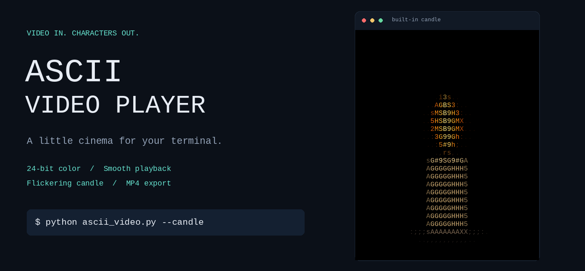
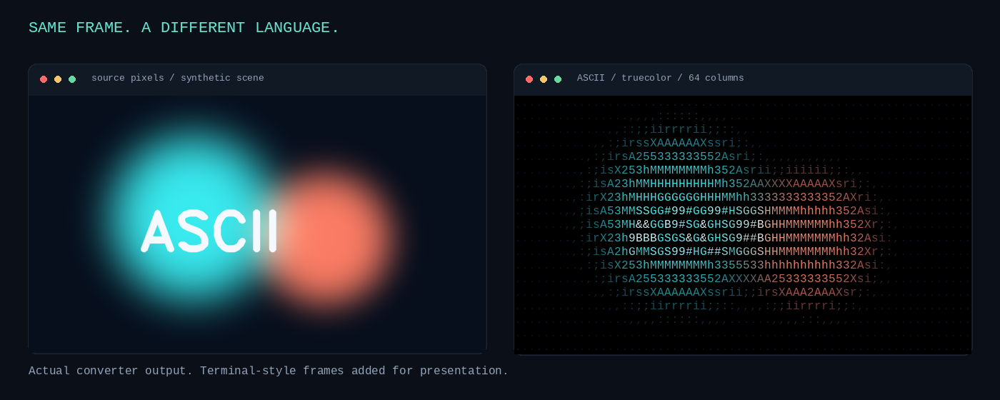
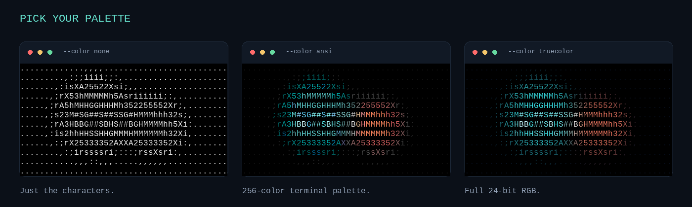

<div align="center">



# ASCII Video Player

**Your videos, reimagined one character at a time.**

Smooth terminal playback. Rich color. A candle for the quiet moments.

Python 3.11+ · OpenCV · NumPy · Pillow · [Apache 2.0 licensed](LICENSE)

[Quick start](#quick-start) · [Gallery](#gallery) · [Examples](#examples) · [Export](#export-an-mp4) · [CLI reference](#cli-reference)

</div>

---

Play a local video as animated ASCII art, or run the app without arguments to
watch a softly flickering candle. Find a look you like, then export it to MP4.

```bash
python ascii_video.py video.mp4
```

## Gallery

### From pixels to characters



The same frame passes through the real conversion pipeline: resize, measure
brightness, choose a character, and retain the sampled color.

### Pick your palette



Use `none` for a classic text look, `ansi` for the 256-color terminal palette,
or `truecolor` for full RGB.

*These are static previews from the project’s renderer, with decorative terminal
framing—not desktop screenshots. The player itself animates in your terminal.*

<details>
<summary><strong>Recreate the images</strong></summary>

After installing the project, run from its root:

```bash
python scripts/make_readme_assets.py
```

The script renders the built-in candle and a reproducible synthetic scene into
`docs/images/`. No downloaded footage or stock images are needed.

</details>

## Features

| Feature | What you get |
| :--- | :--- |
| **Just press play** | Automatic terminal sizing and source-FPS playback |
| **Color your way** | Monochrome, ANSI 256-color, and 24-bit RGB |
| **Keep the proportions** | Aspect correction for tall terminal characters |
| **Make it yours** | Three character ramps, inversion, trimming, and looping |
| **Stay in time** | Monotonic scheduling with frame skipping under load |
| **A candle, built in** | Warm colors and a procedural flickering flame |
| **Take it with you** | MP4 export with optional original-audio attachment |
| **Leave things tidy** | Buffered redraws and cursor restoration on Ctrl+C |

## Quick start

Clone the repository (or download its ZIP from GitHub):

```bash
git clone https://github.com/arwvah/ascii-video-player.git
```

Open a terminal in the `ascii-video-player` directory. Python 3.11 or newer must
already be installed. No GUI or OpenCV desktop libraries are required.

### Linux

Run in bash:

```bash
cd ~/ascii-video-player
python3 -m venv .venv
source .venv/bin/activate
python -m pip install -e '.[dev]'
python ascii_video.py
python ascii_video.py video.mp4
```

On Debian/Ubuntu, optional audio and font dependencies: `sudo apt install ffmpeg fonts-dejavu-core`.
On Arch/Omarchy: `sudo pacman -S ffmpeg ttf-dejavu`.

### macOS

Run in Terminal:

```bash
cd ~/ascii-video-player
python3 -m venv .venv
source .venv/bin/activate
python -m pip install -e '.[dev]'
python ascii_video.py --candle
python ascii_video.py video.mp4
```

With Homebrew installed, `brew install python ffmpeg` supplies Python and optional
audio support. The exporter uses the built-in Menlo or Monaco font.

### Windows

Run in PowerShell, preferably inside Windows Terminal:

```powershell
cd $HOME\ascii-video-player
py -3 -m venv .venv
.\.venv\Scripts\python.exe -m pip install -e ".[dev]"
.\.venv\Scripts\python.exe ascii_video.py --candle
.\.venv\Scripts\python.exe ascii_video.py video.mp4
```

Activation is optional; these commands avoid PowerShell execution-policy changes.
For audio support, `winget install --id Gyan.FFmpeg -e`, then open a new terminal.
The exporter uses the Windows Consolas font.

You can also install runtime dependencies with `python -m pip install -r requirements.txt`.
An editable installation adds the equivalent `ascii-video` command.

## Examples

### Light a candle

```bash
python ascii_video.py
python ascii_video.py --candle --end 5
```

No input file needed. Without `--end`, the candle keeps flickering until Ctrl+C.

### Play it your way

```bash
python ascii_video.py video.mp4 --width 100
python ascii_video.py video.mp4 --color truecolor --charset detailed
python ascii_video.py video.mp4 --color ansi --invert --loop
python ascii_video.py video.mp4 --start 2 --end 8 --fps 24
python ascii_video.py --candle --end 5
python ascii_video.py --help
```

Press **Ctrl+C** to stop. Playback restores the original screen and cursor. With
no arguments the candle runs until interrupted and prints a brief usage message.
Playback is silent; original audio is attached only to exports.

### Phone-recorded portrait footage

```bash
python ascii_video.py phone-portrait.mp4 --width 60 --height 45
```

The image fits inside the requested character box while preserving its proportions.

## Export an MP4

Save your chosen look as a video file:

```bash
python ascii_video.py video.mp4 --export --width 120 --output art.mp4
```

Keep only a section, or save the candle itself:

```bash
python ascii_video.py video.mp4 --export --start 2 --end 8 --fps 24 --output clip.mp4
python ascii_video.py --candle --export --end 6 --output candle.mp4
```

| Detail | Export behavior |
| :--- | :--- |
| **Picture** | Monospaced glyphs rendered into MP4 frames |
| **Timing** | Source FPS by default; overrides resample without changing duration |
| **Audio** | First source track trimmed and encoded as AAC when FFmpeg is available |
| **Without FFmpeg** | Silent output with a clear warning for video sources |
| **Existing files** | Protected unless you explicitly pass `--force` |
| **Candle duration** | 10 seconds by default; use `--end` to choose another duration |

To intentionally replace an export:

```bash
python ascii_video.py video.mp4 --export --output art.mp4 --force
```

> Terminal playback is silent. Audio is attached to exports only. MP4 uses
> MPEG-4 Part 2 (`mp4v`), suitable for desktop players such as VLC but not
> supported by every web browser.

## CLI reference

```bash
python ascii_video.py --help
```

| Option | Behavior |
| --- | --- |
| `--width N`, `--height N` | Grid bounds, 1–1000 characters; preserve aspect ratio |
| `--fps N` | Output FPS, greater than 0 through 240; default source FPS or candle 30 |
| `--color none/ansi/truecolor` | White text, xterm 256 colors, or 24-bit RGB; default truecolor |
| `--charset simple/standard/detailed` | Brightness ramp; default standard |
| `--invert` | Reverse the character ramp |
| `--loop` | Repeat terminal playback indefinitely |
| `--start S`, `--end S` | Nonnegative start and exclusive end timestamps |
| `--candle` | Procedural animation; cannot be combined with a video |
| `--export` | Render a finite MP4; candle defaults to 10 seconds |
| `--output PATH` | Destination; default `ascii-output.mp4` |
| `--force` | Explicitly allow replacing an existing export |

Width and height form an aspect-preserving box, so a requested height may not be
fully used if width is limiting. Height alone selects a height within the default
width bound. Terminal output fits the current window, reserves one row and column,
and caps automatic resolution at 300 × 150 for performance. Tiny terminals still
render at least one character. Resizing the terminal updates the next frame.
Exports default to a 120 × 240 character bounding box independent of terminal size.

## How it works

```text
Video file                 Procedural candle
    │                             │
    └──────────────┬──────────────┘
                   ▼
         Resize + aspect correction
                   │
         Brightness → characters
         Sampled pixels → colors
                   │
          ┌────────┴─────────┐
          ▼                  ▼
    ANSI terminal      Monospaced glyphs
    buffered redraws         │
                             ▼
                         MP4 export
                             │
                      Optional audio mux
```

OpenCV decodes BGR frames. NumPy maps resized luminance values onto a ramp from
sparse to dense characters. Terminal characters are assumed to be twice as tall
as they are wide, so the grid height is corrected by a factor of 0.5. Colors come
from the sampled image; ANSI mode chooses the nearest cube or grayscale color.
Each frame is buffered into one write with cursor repositioning—no shell clearing.

Playback schedules frames against an absolute monotonic clock. When rendering
falls behind, it skips obsolete frames rather than accumulating delay. An FPS
override resamples the source timeline, keeping duration unchanged. OpenCV frame
counts and nominal FPS are used; variable-frame-rate videos are approximated.
Source seeking is frame-granular, so trim boundaries round to source frames.

Export uses a cached, antialiased monospaced glyph atlas and vectorized raster
assembly. Its aspect correction uses the actual font cell dimensions. MP4 uses
OpenCV's MPEG-4 Part 2 (`mp4v`) encoder; frames are padded to even pixel dimensions.
If FFmpeg is installed, the first source audio track is trimmed and encoded as AAC.
Missing FFmpeg or failed audio attachment produces a warning and a silent MP4.
Silent input stays silent. Exports never loop. Duration differs from the selected
source interval by less than one output frame. FFmpeg is used only for audio muxing.

Existing destinations are protected unless `--force` is supplied; the source video
cannot be the destination. Encoding takes place in a temporary directory beside
the destination. Failed encoding and Ctrl+C clean up temporary files.

## Development

```text
ascii-video-player/
├── ascii_video.py          # Source-checkout entry point
├── ascii_player/
│   ├── cli.py              # Arguments and validation
│   ├── converter.py        # Resizing, character mapping, colors
│   ├── player.py           # Decode, schedule, skip, loop
│   ├── terminal.py         # ANSI lifecycle and terminal sizing
│   ├── candle.py           # Procedural flickering candle
│   └── exporter.py         # Glyph rasterization, MP4, audio
├── docs/images/            # README previews
├── scripts/                # Sample generation and smoke checks
└── tests/                  # Conversion, CLI, timing, export tests
```

### Tests and smoke checks

```bash
python -m pytest -q
python ascii_video.py --help
python scripts/make_sample.py --output sample.mp4
python ascii_video.py sample.mp4 --width 60
python ascii_video.py sample.mp4 --export --output sample-ascii.mp4
python ascii_video.py --candle --end 2
```

The sample generator creates a two-second landscape clip with gradients and moving
shapes. Add `--portrait` to generate a phone-shaped clip. The generator refuses to overwrite existing files.

**Verified on Linux:** 28 automated tests passed, plus CLI help, pseudo-terminal
playback, looping, Ctrl+C restoration, portrait export, and trimmed audio/video
export. See [VERIFICATION.md](VERIFICATION.md) for the environment and results.

## Troubleshooting and limits

- **ANSI escape codes appear literally:** use Windows Terminal, Terminal.app, or a
  modern Linux terminal. Non-interactive output is rejected; use `--export`.
- **Playback is slow:** lower `--width` or use `--color none`. Truecolor output is
  bandwidth-heavy. Dropped frames under load are intentional.
- **Aspect looks off:** use a monospaced terminal font with approximately 1:2 cells.
- **Cannot open/decode video:** check the path and codec. Corrupt or truncated
  videos report the failed frame. Network streams and unknown-length files are
  not supported. OpenCV codec availability varies by platform.
- **No export font:** install DejaVu Sans Mono using your OS package manager.
- **No exported audio:** ensure `ffmpeg -version` works in the same terminal and
  the input contains audio. Only the first audio track is used.
- **MP4 will not play in a browser:** some browsers require H.264; use a desktop
  media player such as VLC. This project exports portable MP4 containers with
  `mp4v` video, not guaranteed browser-compatible H.264.
- **Large export:** reduce width/height. Exports reject grids over 100,000 cells
  to bound memory usage. Low-resolution inputs can look blocky when enlarged.
- **Rotation metadata:** OpenCV normally applies supported orientation metadata;
  codec/backend support varies. Normalize rotation beforehand if needed.

Linux verification is included. macOS and Windows paths and console support are
implemented but require testing on those operating systems. No sound plays in
the terminal. No external image assets or fonts are bundled.

## License

[Apache License 2.0](LICENSE). Make something fun with it.

Third-party components retain their respective licenses.
